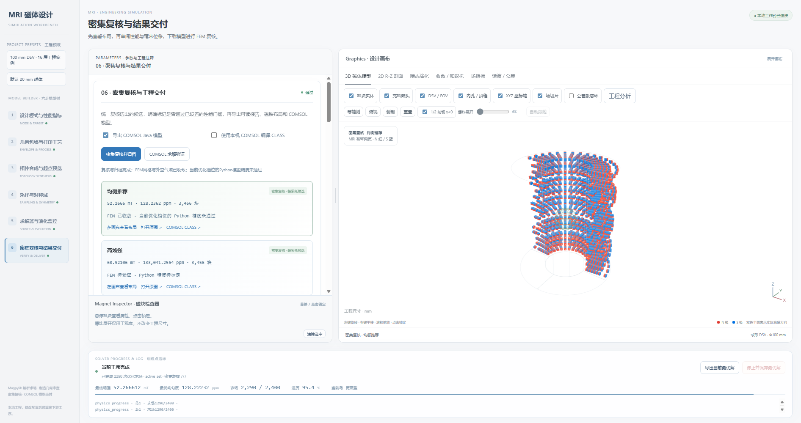
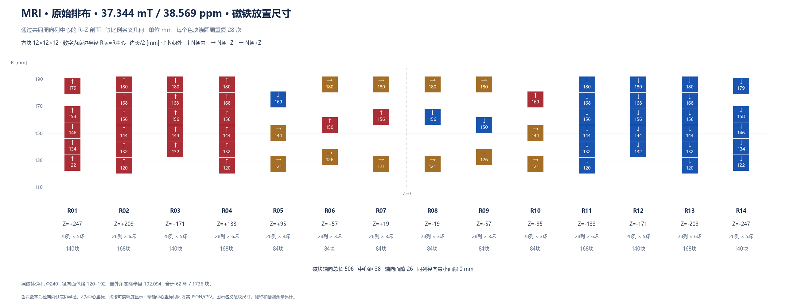
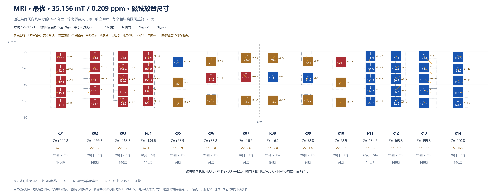
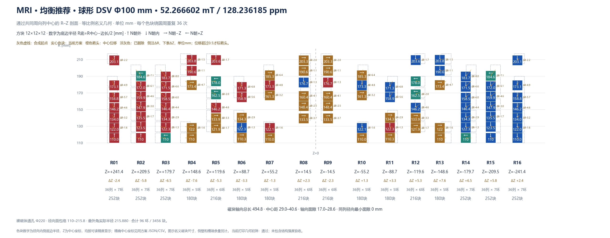
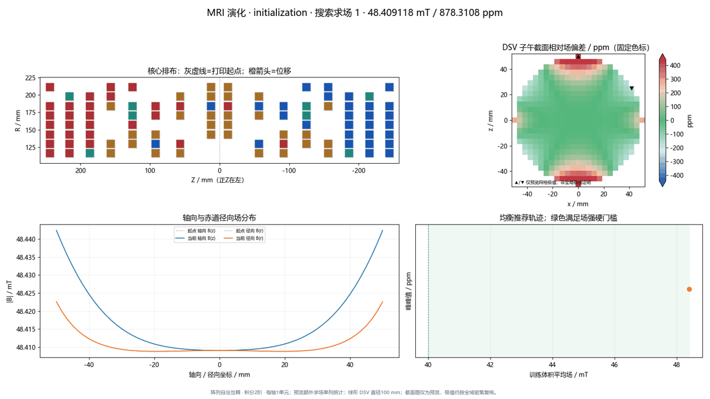

# MRI Magnet Workbench · MRI 磁体优化工作台

面向永磁 MRI 磁体的本地六步仿真工作台：用 Magpylib 求场，检查制造约束，搜索磁环排布，并导出 COMSOL 验证模型。**V6 新增阵列自洽互耦优化**，同时保留离线三维交互、二维尺寸图、瞬态演化、预算预检与可读性结果归档。详见 [V6 操作说明](V6_阵列互耦操作说明.md)。



*实际V6工程结果：3456块磁铁的耦合优化与交付工作台。FEM收敛与Python模型精度分别显示；该单单元档位的PPM精度尚未通过，不把求解完成当作模型精度合格。*

V6的正式求场在每次几何变更后重新求解阵列自洽磁化。Bz球谐谱与Z6/Z8诊断、制造公差统计及三维正交切片保留为独立工程分析；默认跟随当前运行模型，另选模型时明确标为对照。

左上角提供 **V5 / V6 版本选择**：在独立窗口进入另一版本，当前仿真继续运行。指标、评分和帕累托选择已统一，维护约定与A1–A3核对见 [工程维护说明](docs/engineering-maintenance.md) 和 [贡献约定](CONTRIBUTING.md)。

## 快速开始

已在 Windows / Python 3.9 上验证。浏览器使用本地 WebGL 资源，运行界面不需要访问 CDN；首次安装 Python 依赖需要网络。COMSOL 是可选验证工具。

在 PowerShell 中执行：

```powershell
git clone https://github.com/lithos666/mri-magnet-workbench.git
cd mri-magnet-workbench
python -m venv .venv
.\.venv\Scripts\python.exe -m pip install -r requirements.txt
.\.venv\Scripts\Activate.ps1
python py_main.py workbench serve
```

打开 **http://127.0.0.1:8765**。若系统不允许激活脚本，后续命令中的 `python` 可直接替换成 `.\.venv\Scripts\python.exe`。也可双击根目录的 `启动工作台.cmd`。

六步流程共用同一份工程配置：**指标 → 包络与工艺 → 拓扑起点 → 采样 → 优化 → 密集复核与交付**。每个工程独立保存在 `results/`，修改参数后按提示重新运行受影响步骤。拖动中间分隔条可调整参数区和画布宽度；3D 画布支持旋转、平移、缩放、剖切、爆炸展开与磁块属性检查。

## 案例 1：基于已有排布进行优化

读取仓库内附带的真实排布，先进行源槽保留组合评估与 PAVA 最小改动投影，再优化磁环半径和镜像层位置。

下面展示一组**V5历史演进优化结果（旧固定源模型）**：评价区域为 **z = 0、直径 20 mm 的圆形 FOV**，采用 `remanence` 磁化模型。

| 排布 | 平均场强 / mT | 峰峰值 / ppm | 磁铁块数 |
| --- | ---: | ---: | ---: |
| 原始裸磁体 | 37.344304 | 38.568931 | 1736 |
| PAVA 可打印起点 | 35.196192 | 41.653823 | 1624 |
| 优化后 | **35.155705** | **0.208702** | **1624** |

**原始磁铁布局：**



**优化后的磁铁布局：** 灰色虚线为可打印起点，实心块为优化后位置，橙色标注为毫米级位移。



相对可打印起点，ppm 下降 **99.499%**，平均场强下降约 **0.0405 mT**。这是匀场改善的实例，未声称同时增场。对应设计与指标见 [历史结果数据](examples/seeded/reference_result/metrics.json)。历史运行使用了暖启动、不同预算及磁化模型；下方配置用于新的运行，不能直接视作这些指标的逐项复现配置。

**可运行的示例配置：**

| 项目 | 配置 |
| --- | --- |
| 输入排布 | 14 层、62 环、1736 块，每环 28 块 |
| 评价域 | **z = 0、直径 20 mm 的平面圆形 FOV** |
| 性能门槛 | 面积加权平均场强 ≥ 30 mT，峰峰值不均匀度 ≤ 1000 ppm |
| 磁块 | 12 × 12 × 12 mm，Br = 1.43 T，μr = 1.05 |
| 搜索策略 | 默认固定工艺投影后的拓扑，优化 R/Z；可在配置中开启环数和列数搜索 |
| 求解预算 | 2400 次优化求场，种群 32，坐标/成对精修 240 次，LP 精修 300 次 |

```powershell
python py_main.py workbench serve --project results/seeded --config examples/seeded/config.json
```

按六步向导执行，Step 3 查看原始排布与可打印起点的区别。示例采用的工艺投影会得到 58 环 / 1624 块起点；原始裸磁体和制造合法起点分别保留，供最终对比。

配置和详细操作见 [examples/seeded](examples/seeded/README.md)。磁铁允许同列紧贴，仍禁止重叠，并保留槽端、内外壁和周向工艺余量。

## 案例 2：根据需求从零搜索 · V6 阵列互耦

**不读取已有磁铁排布文件**。独立环线性基底提出不同拓扑；整阵列互耦决定起点排序、多岛晋级、DE、成对补偿与 LP 精修，以及最终密集复核。

真实工程采用 **100 mm 球形 DSV、16 层、12 mm N52、Br=1.43 T、μr=1.05**，平均场硬门槛为40 mT；通过门槛后均衡优化场强与不均匀度。

| 方案（同一耦合密集口径） | 体积平均场强 / mT | 峰峰值 / ppm | 磁铁块数 |
| --- | ---: | ---: | ---: |
| 旧固定源优化方案，改用耦合重评 | 50.779530 | 639.568051 | 3456 |
| V6 均衡推荐 | 52.266602 | 128.236185 | 3456 |
| V6 高场强 | 60.921059 | 133041.256433 | 3456 |
| V6 最低 ppm | 44.636291 | 107.054972 | 3248 |



相对旧算法方案在同一耦合模型下的结果，V6均衡推荐场强提高 **2.928%**，ppm下降 **79.950%**。两者均采用4103点体积加权密集复核与连续极值细化；旧固定源模型给出的126.917 ppm不能直接与本表的耦合指标比较。



完整材料与三类设计见 [V6精简结果](examples/de_novo/v6_reference_result/metrics.json)，三档网格、外空气域检查及误差见 [FEM对照记录](examples/de_novo/v6_reference_result/fem_summary.json)。

**两套均衡方案的实际COMSOL对照：**使用相同4103个采样点、体积权重与原始Br/μr；分别通过三级网格和扩大外空气域的收敛检查。以下为FEM采样极值口径，独立于上表的Python连续极值细化。

| 实际收敛FEM | 体积平均场强 / mT | 采样峰峰值 / ppm |
| --- | ---: | ---: |
| 旧模型优化的均衡方案 | 50.782305 | 600.405076 |
| V6互耦优化的均衡方案 | 52.267520 | 174.169998 |

实际FEM对照中，V6方案场强提高 **2.925%**，采样PPM下降 **70.991%**。这确认了所示几何的实际改善；原Python单单元档位的精度误差仍须单独审查。

**FEM网格与外域检查已收敛，但当前Python离散档位尚未通过模型精度门槛。** 保留耦合优化成绩与误差记录，不能把这组结果标为工程精度合格；需按操作说明提高积分或空间离散并开启新运行。

**同一几何的独立精度标定：每块细分2×2×2单元、8点积分后通过本次FEM精度门槛。** 这档精度没有用于上表已归档的优化，不能把其合格状态转移给原单单元优化指标。

| 同一均衡几何的计算档位 | 平均场强 / mT | 采样峰峰值 / ppm | 精度状态 |
| --- | ---: | ---: | --- |
| 原单单元、8点积分 | 52.266602 | 128.236070 | 未通过 |
| 每块8子单元、各8点积分 | 52.263748 | 158.060056 | 独立标定通过 |
| 收敛COMSOL FEM | 52.267520 | 174.169998 | 网格与外域收敛 |

高精度档PPM误差为16.109942，低于本次门槛17.417000 ppm。详见 [独立精度标定](examples/de_novo/v6_reference_result/calibration_summary.json)。已开启独立300次高精度校正运行，尚未完成，不属于上表已归档成绩。

| 约束与计算项 | 本次工程设置 |
| --- | --- |
| 结构包络 | 内孔直径200 mm；磁块内侧底面≥110 mm；外径≤440 mm；总长≤500 mm |
| 拓扑 | 固定8对镜像层；每环24～36偶数块；径向环数由制造有效净空自动推算，最多8环 |
| 工艺 | 径向通槽；周向隔墙1.6 mm；内外壁2.4 mm；底板5 mm；层间净空2 mm；中心两层磁块间隙≥10 mm |
| 打印 | 单机255×255×255 mm，四分块；有效拼装包络480×480×255 mm |
| 正式求场 | 原始Br=1.43 T，μr=1.05；整阵列线性回复自洽；每块1单元、8点体积积分 |
| 评估预算 | 上限2400次，实际计费2290次；种群32、坐标/成对240次、LP240次、单进程 |
| 初始随机种子 | 20261101 |

本次工程运行在中断后保留已完成候选及预算，并从物理精英重启后续阶段，**不是随机数状态精确重放**。仓库配置用于相同工程约束的新运行，不保证逐点重现这组指标。有限预算内最佳方案未被证明为全局最优。

```powershell
python py_main.py workbench serve --project results/de_novo_v6 --config examples/de_novo/v6_config.json
```

Step 3选择拓扑簇，Step 4检查物理模型、采样和成本，Step 5查看各岛真实维数及可完成精修轮数，Step 6对比三类推荐。需要搜索5～8对层时，可改 `de_novo.pair_counts` 为 `[5,6,7,8]`，并相应增加预算。详见 [案例操作](examples/de_novo/README.md)。

**案例1是20 mm平面FOV，案例2是100 mm球形DSV，ppm不能跨案例直接横向比较。**

## 命令行与参数修改

以下命令均在仓库根目录执行。将路径替换为对应案例即可：

```powershell
# 只检查工艺包络，不计算磁场
python py_main.py workbench preflight --project results/de_novo --config examples/de_novo/v6_config.json

# 运行前 3 步，生成起点；已有合格前置步骤会复用
python py_main.py workbench step 3 --auto --project results/de_novo --config examples/de_novo/v6_config.json

# 生成起点后查看各岛求解预算
python py_main.py workbench solver-preflight --project results/de_novo

# 无人值守运行全部六步，仅生成 Java、不编译 CLASS
python py_main.py workbench all --project results/de_novo --config examples/de_novo/v6_config.json --no-compile
```

| 想改什么 | 配置位置 |
| --- | --- |
| DSV / 平面 FOV、直径、场强与 ppm 门槛 | `target` |
| 内孔、外径、总长 | `envelope` |
| 磁块尺寸、剩磁、回复磁导率 | `magnet` |
| 正式互耦模型、积分及单元细分、缓存与资源上限 | `physics` |
| 槽隙、隔墙、底板、打印床、数量上限 | `manufacturing` |
| 从零搜索的层数、列数与初筛规模 | `de_novo` |
| 环数/列数是否参与优化、R/Z 调节范围 | `search` |
| 场强与均匀度的均衡权重和尺度 | `scoring` |
| 训练与密集复核采样 | `sampling` |
| 总预算、种群、并行与精修预算 | `solver` |
| COMSOL 路径、编译与运行验证 | `comsol_root`、`deliverables` |

默认参数入口是 `parameters.py` 的 `WORKBENCH_CONFIG`；两个案例各有独立 JSON。工程保存后，以 `工作台状态.json` 中的 `config` 和运行目录内的配置快照为准；CLI `init` 生成的 `工作台配置.json` 只是初始化导出。需要更换案例时使用不同 `--project`，避免复用旧状态。

## 算法与文件位置

```text
parameters.py                  默认工作台配置
py_main.py                     命令行入口
examples/seeded/                既有排布、配置与操作说明
examples/de_novo/               需求搜索配置与操作说明
mri_magnet/
  field.py                     固定源有限尺寸磁块求场与线性叠加
  field_models.py              正式求场工厂、模型指纹与有界准备缓存
  design_contract.py           统一门槛、评分参数与独立复核指标契约
  material_response.py         完整向量线性回复、自身与阵列互耦
  physics_calibration.py       积分与空间离散精度标定
  manufacturing.py             打印约束、OBB 碰撞与床面容纳审查
  projection.py                PAVA 保序投影
  de_novo.py                   基底格点、灵敏度矩阵和拓扑反演
  topology.py / islands.py     拓扑提案、多岛筛选与晋级
  optimization.py              混合初始化与连续差分进化
  search_moves.py              物理尺度扰动与成对补偿步
  active_set.py                灵敏度 LP 精修
  solver_budget.py             按实际维数预检预算
  sampling.py / validation.py  对称采样与密集极值复核
  evolution.py                 演化看板、GIF 与时间轴
  workbench_archive.py          报表、毫米级尺寸表与候选归档
  comsol_export.py             Java / CLASS 导出
  comsol_validation.py         新建FEM任务、三级网格及外域收敛检查
  workbench*.py / .html / .js  六步工作台与离线三维交互
support/tests/                 Python 与前端回归测试
support/comsol/                已存 FEM 解读取与对标工具
support/setup_environment.ps1  环境安装辅助脚本
docs/images/workbench.png      本页界面截图
```

仓库包含当前工作台的完整前后端源码、物理计算与优化模块、离线三维资源、COMSOL 导出代码、测试和环境脚本。案例图片使用真实运行产物，对应的精简设计与指标保存在各案例的 `reference_result/` 中。

求场前先拦截制造冲突。训练用于搜索，密集采样与连续极值复核用于结果评估；最终同时保存合格候选和明确标记的诊断候选。每次运行生成布局图、演化 GIF、中文速览、毫米尺寸表、候选对比与 HTML 报告。

## COMSOL 验证

两个案例默认只导出 `.java`，Python 优化不依赖 COMSOL。要生成 `.class`，在工作台填写本机安装目录 `comsol_root`，启用 `deliverables.compile` 后执行 Step 6。需要可用的 COMSOL 编译工具和相应许可；仓库不包含 COMSOL 软件、原始大型 MPH 或已编译模型。

导出按磁化方向分组，并记录设计指纹。**CLASS 编译成功不代表 FEM 已求解通过。** 在 COMSOL 中检查几何、划分网格、求解，并使用与 Python 相同的材料、评价域、采样和单位比较。

**材料范围：Br=1.43 T、μr=1.05。** V6以原始Br和线性回复磁导率建立 `J=Br·n+μ0(μr−1)H_local`，包含自身及其他磁块的局部场，保留三个磁化分量；**没有采用这一批磁铁实测的完整J–H曲线**，也不预测膝点、不可逆退磁或温度退磁。Br不是耦合后每块磁铁的固定J值。COMSOL同样输入原始Br与μr，避免重复施加退磁修正。

FEM验收要求平均场相对误差≤0.5%，PPM差≤max(10 ppm, FEM PPM的10%)；只有网格和外空气域收敛后才作精度参考。性能门槛、模型精度与FEM验证分别报告。操作见 [V6说明](V6_阵列互耦操作说明.md)。

## 测试与依赖说明

完整回归测试还需安装 Node.js，并确保 `node` 在 PATH 中；正常使用网页无需 Node。依赖安装完成后执行：

```powershell
python -m unittest discover -s support/tests -v
```

当前验证（2026-11-04）：**584项前后端回归测试全部通过，0跳过**。物理模型、缓存隔离、互耦优化闭环、优雅停止、FEM任务绑定和原六步界面均纳入回归。实际工程成绩及FEM状态见上方案例，测试通过不替代FEM精度验收。仓库不附带全量历史运行目录或虚拟环境。

三维资源随仓库提供，保留 [Three.js MIT 许可](mri_magnet/vendor/THREE-LICENSE.txt)；其他依赖遵循各自许可证。本仓库暂未指定项目代码的再许可条款。
