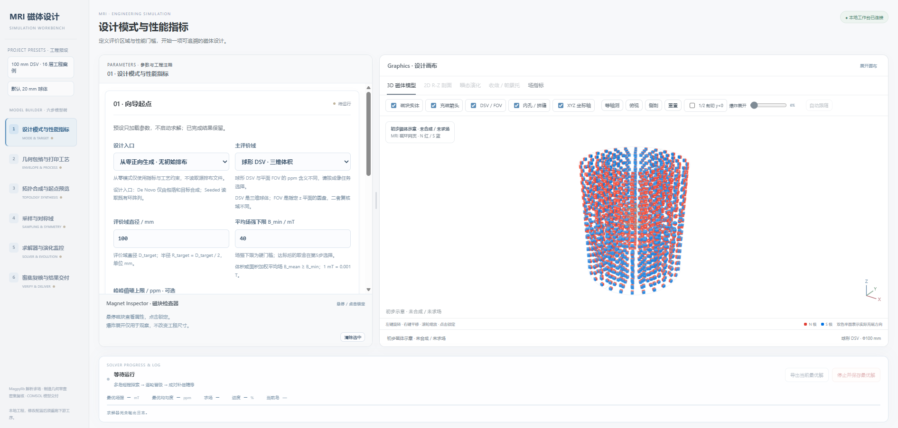

# MRI Magnet Workbench · MRI 磁体优化工作台

面向永磁 MRI 磁体的本地六步仿真工作台：用 Magpylib 快速求场，检查制造约束，搜索磁环排布，并导出 COMSOL 验证模型。当前界面为 **v5**，支持离线三维交互、二维尺寸图、瞬态演化、预算预检与可读性结果归档。



*界面实拍。图中为打开工程时自动显示的初步磁体示意，尚未合成或求场，不代表已优化结果。红蓝两半表示 N/S 极。*

## 快速开始

已在 Windows / Python 3.9 上验证。浏览器使用本地 WebGL 资源，运行界面不需要访问 CDN；首次安装 Python 依赖需要网络。COMSOL 是可选验证工具。

在 PowerShell 中执行：

```powershell
git clone https://github.com/lithos666/mri-magnet-workbench.git
cd mri-magnet-workbench
python -m venv .venv
.\.venv\Scripts\python.exe -m pip install -r requirements.txt
.\.venv\Scripts\Activate.ps1
python py_main.py workbench serve
```

打开 **http://127.0.0.1:8765**。若系统不允许激活脚本，后续命令中的 `python` 可直接替换成 `.\.venv\Scripts\python.exe`。也可双击根目录的 `启动工作台.cmd`。

六步流程共用同一份工程配置：**指标 → 包络与工艺 → 拓扑起点 → 采样 → 优化 → 密集复核与交付**。每个工程独立保存在 `results/`，修改参数后按提示重新运行受影响步骤。拖动中间分隔条可调整参数区和画布宽度；3D 画布支持旋转、平移、缩放、剖切、爆炸展开与磁块属性检查。

## 案例 1：基于已有排布进行优化

读取仓库内附带的真实排布，先进行源槽保留组合评估与 PAVA 最小改动投影，再优化磁环半径和镜像层位置。

| 项目 | 配置 |
| --- | --- |
| 输入排布 | 14 层、62 环、1736 块，每环 28 块 |
| 评价域 | **z = 0、直径 20 mm 的平面圆形 FOV** |
| 性能门槛 | 面积加权平均场强 ≥ 30 mT，峰峰值不均匀度 ≤ 1000 ppm |
| 磁块 | 12 × 12 × 12 mm，Br = 1.43 T，μr = 1.05 |
| 搜索策略 | 默认固定工艺投影后的拓扑，优化 R/Z；可在配置中开启环数和列数搜索 |
| 求解预算 | 2400 次优化求场，种群 32，坐标/成对精修 240 次，LP 精修 300 次 |

```powershell
python py_main.py workbench serve --project results/seeded --config examples/seeded/config.json
```

按六步向导执行，Step 3 查看原始排布与可打印起点的区别。示例采用的工艺投影会得到 58 环 / 1624 块起点；原始裸磁体和制造合法起点分别保留，供最终对比。

配置和详细操作见 [examples/seeded](examples/seeded/README.md)。磁铁允许同列紧贴，仍禁止重叠，并保留槽端、内外壁和周向工艺余量。

## 案例 2：基于需求进行广泛搜索

**不读取已有排布文件**。根据指标、包络、材料和打印约束建立磁环基底与灵敏度矩阵，生成多个拓扑起点，再通过多岛筛选把预算集中到更有潜力的方案。

| 项目 | 配置 |
| --- | --- |
| 评价域 | **原点处直径 100 mm 的球形 DSV** |
| 性能与评价 | 体积加权平均场强 ≥ 40 mT，通过门槛后均衡优化场强和峰峰值 ppm |
| 几何 | 保护内孔直径 200 mm，外径 ≤ 440 mm，总长 ≤ 500 mm，磁块内侧底面半径 ≥ 110 mm |
| 磁块 | 12 × 12 × 12 mm，Br = 1.43 T，μr = 1.05，最多 4608 块 |
| 拓扑范围 | 5～8 对镜像层、24～36 偶数列；径向环数按有效净空自动推算 |
| 工艺 | 径向通槽，周向隔墙 1.6 mm，外壁 2.4 mm，底板 5 mm；四分块拼装 |
| 初筛与预算 | 候选池 20，最多保留 5 个起点；3600 次优化求场，种群 32，坐标/成对精修 240 次，LP 精修 300 次 |

```powershell
python py_main.py workbench serve --project results/de_novo --config examples/de_novo/config.json
```

Step 3 选择进入深度优化的候选，Step 5 启动前查看各岛实际维数、可完成轮数和预算截断提示。Step 6 对比密集复核后的均衡推荐、高场强与最低 ppm 方案。

配置和详细操作见 [examples/de_novo](examples/de_novo/README.md)。若只允许 16 层，把 `de_novo.pair_counts` 改成 `[8]`；界面顶部的 **100 mm DSV · 16 层工程预设**也可加载这组固定层数约束。案例默认未设置硬 ppm 上限，搜索得到的指标以实际运行和复核为准。

**两案例的评价区域不同，ppm 不能直接横向比较。** 搜索是有限预算的工程优化，不保证全局最优。

## 命令行与参数修改

以下命令均在仓库根目录执行。将路径替换为对应案例即可：

```powershell
# 只检查工艺包络，不计算磁场
python py_main.py workbench preflight --project results/de_novo --config examples/de_novo/config.json

# 运行前 3 步，生成起点；已有合格前置步骤会复用
python py_main.py workbench step 3 --auto --project results/de_novo --config examples/de_novo/config.json

# 生成起点后查看各岛求解预算
python py_main.py workbench solver-preflight --project results/de_novo

# 无人值守运行全部六步，仅生成 Java、不编译 CLASS
python py_main.py workbench all --project results/de_novo --config examples/de_novo/config.json --no-compile
```

| 想改什么 | 配置位置 |
| --- | --- |
| DSV / 平面 FOV、直径、场强与 ppm 门槛 | `target` |
| 内孔、外径、总长 | `envelope` |
| 磁块尺寸、剩磁、回复磁导率 | `magnet` |
| 槽隙、隔墙、底板、打印床、数量上限 | `manufacturing` |
| 从零搜索的层数、列数与初筛规模 | `de_novo` |
| 环数/列数是否参与优化、R/Z 调节范围 | `search` |
| 场强与均匀度的均衡权重和尺度 | `scoring` |
| 训练与密集复核采样 | `sampling` |
| 总预算、种群、并行与精修预算 | `solver` |
| COMSOL 路径、编译与运行验证 | `comsol_root`、`deliverables` |

默认参数入口是 `parameters.py` 的 `WORKBENCH_CONFIG`；两个案例各有独立 JSON。工程保存后，以 `工作台状态.json` 中的 `config` 和运行目录内的配置快照为准；CLI `init` 生成的 `工作台配置.json` 只是初始化导出。需要更换案例时使用不同 `--project`，避免复用旧状态。

## 算法与文件位置

```text
parameters.py                  默认工作台配置
py_main.py                     命令行入口
examples/seeded/                既有排布、配置与操作说明
examples/de_novo/               需求搜索配置与操作说明
mri_magnet/
  field.py                     Magpylib 有限尺寸磁块求场与线性叠加
  manufacturing.py             打印约束、OBB 碰撞与床面容纳审查
  projection.py                PAVA 保序投影
  de_novo.py                   基底格点、灵敏度矩阵和拓扑反演
  topology.py / islands.py     拓扑提案、多岛筛选与晋级
  optimization.py              混合初始化与连续差分进化
  search_moves.py              物理尺度扰动与成对补偿步
  active_set.py                灵敏度 LP 精修
  solver_budget.py             按实际维数预检预算
  sampling.py / validation.py  对称采样与密集极值复核
  evolution.py                 演化看板、GIF 与时间轴
  workbench_archive.py          报表、毫米级尺寸表与候选归档
  comsol_export.py             Java / CLASS 导出
  workbench*.py / .html / .js  六步工作台与离线三维交互
support/tests/                 Python 与前端回归测试
support/comsol/                已存 FEM 解读取与对标工具
docs/images/workbench.png      本页界面截图
```

求场前先拦截制造冲突。训练用于搜索，密集采样与连续极值复核用于结果评估；最终同时保存合格候选和明确标记的诊断候选。每次运行生成布局图、演化 GIF、中文速览、毫米尺寸表、候选对比与 HTML 报告。

## COMSOL 验证

两个案例默认只导出 `.java`，Python 优化不依赖 COMSOL。要生成 `.class`，在工作台填写本机安装目录 `comsol_root`，启用 `deliverables.compile` 后执行 Step 6。需要可用的 COMSOL 编译工具和相应许可；仓库不包含 COMSOL 软件、原始大型 MPH 或已编译模型。

导出按磁化方向分组，并记录设计指纹。**CLASS 编译成功不代表 FEM 已求解通过。** 在 COMSOL 中检查几何、划分网格、求解，并使用与 Python 相同的材料、评价域、采样和单位比较。

Magpylib 使用给定均匀磁化的有限磁块解析模型；示例开启孤立立方体自退磁近似，未包含完整磁体互耦。计算候选的最终性能需要 FEM 与实物测量确认。

## 测试与依赖说明

完整回归测试还需安装 Node.js，并确保 `node` 在 PATH 中；正常使用网页无需 Node。依赖安装完成后执行：

```powershell
python -m unittest discover -s support/tests -v
```

发布验证（2026-11-02）：**414 项前后端回归测试全部通过，0 跳过**；两套案例的配置与工艺预检均通过。大规模优化仍需在自己的设备上按预算运行，仓库不附带历史运行结果或虚拟环境。

三维资源随仓库提供，保留 [Three.js MIT 许可](mri_magnet/vendor/THREE-LICENSE.txt)；其他依赖遵循各自许可证。本仓库暂未指定项目代码的再许可条款。
