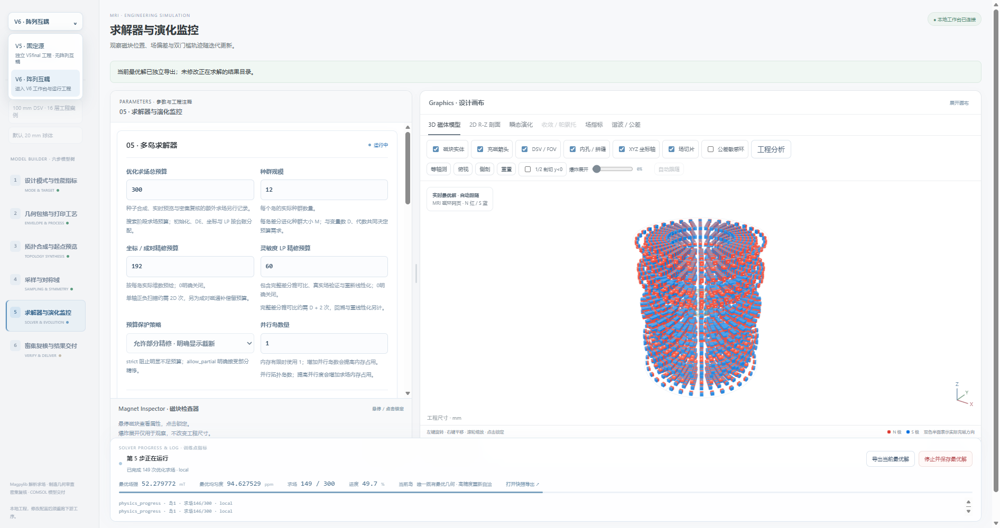

# 工程维护与问题核对

本次完整前后端回归：**584项通过、0跳过**。实际浏览器验证V6正在运行时仍能使用版本菜单，切换到独立V5页时没有发送配置、停止或求解POST请求。

| 项目 | 核对结果与处理 |
|---|---|
| A1：FEM结论没有更新HTML | 确认。旧补写逻辑寻找`报告.html`，实际归档使用`report_中文.html`。现优先读清单的安全报告路径，再回退正式/历史文件名；同时更新对应卡片、首页状态和证据链接。新增真实`archive_run`生成报告的回归，包括重复补写、失败或旧证书撤销、非匹配候选不受影响。 |
| A2：帕累托口径分叉 | 确认，报告中还存在第三处手写支配判断。现统一到`objectives.pareto_front`，统一独立复核优先级与候选归并；CSV、HTML、导出选择和清单都使用同一记录口径。 |
| A3：需求尺度重复 | 确认顶层`ppm_scale`字段不一致；现由`design_contract.requirements_for`统一构造。原均衡损失本身已读取`scoring.ppm_scale`，所以不能断言旧版每次都会因此改排名。 |
| A3：`popsize=3`和显式人口并存 | 确认冗余配置。SciPy在提供二维`init`时使用其行数，因此旧`popsize=3`没有把本轮显式12人口改成3。工作台现只传`population_size`；旧CLI乘数仅在未指定显式人口时作兼容回退。 |

无用导入清除了8个；保留仍被调用的旧CLI、验证状态、3D回退渲染器、后台启动/恢复/自动收尾脚本。兼容API通过重导出保留，不复制算法实现。

## 版本入口



左上菜单打开独立窗口，原仿真继续。现场地址：V5 `http://127.0.0.1:8764/`，当前高精度V6 `http://127.0.0.1:8766/`。默认V6服务也可使用8765端口。菜单根据同一本机浏览器的运行端口记录返回正在求解的V6，而不把当前工程改成另一种物理模型。

V5使用独立冻结源码、解释器和工程。其页面仅在响应时注入共享版本选择组件，原V5发布文件保持原字节；原`V5final.exe`保留。

已经安装V5final后，可使用其解释器启动独立入口：

```powershell
V5final\runtime\python.exe "Python code\support\serve_v5final.py" --installation V5final
```

## 单一源码与归档

现场源码只在`Python code`的Git工作树维护；V5final是冻结发布。`results/`中的原始排布、求场检查点、采样CSV、真实代码快照与FEM收敛记录属于工程证据，不作为可编辑源码。

旧构建、测试缓存和打包副本按已批准的清单清理。完整备份、逐文件SHA256和执行记录保存于`Python code`同级的`维护归档`，避免散落多套可执行源码。Git忽略构建、输出与备份目录；新增临时调试应使用系统临时目录。

正在运行的进程无需重启。新增依赖先部署共享契约，并已测试“旧objectives缓存仍在”的延迟导入情形；本轮场强门槛40mT、ppm尺度1000及显式人口12下，需求字典与64组评分保持完全一致。归档与标签修复属于有意的报告变化。
