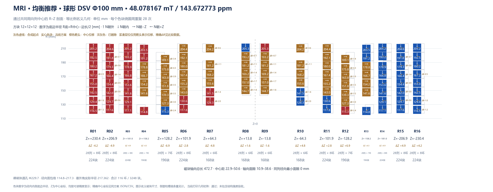

# 案例二：基于需求的广泛搜索

本案例**不读取已有磁铁排布**。从包络、材料、制造约束与磁场目标建立磁环基底，用线性灵敏度反演生成候选拓扑，再进行多岛筛选、连续演化、成对补偿与 LP 精修。



上图为历史固定 16 层工程运行的均衡推荐解：100 mm 球形 DSV、48.078167 mT / 143.672773 ppm / 3248 块，未完成 FEM 求解验证。下方示例已扩展层数、列数与预算，不保证输出相同排布。真实设计与指标见 [reference_result](reference_result/metrics.json)。

| 配置项 | 本案例设置与含义 |
| --- | --- |
| 评价域 | 原点处**直径 100 mm 的球形 DSV**，平均场按体积加权 |
| 性能目标 | 平均场强 ≥ 40 mT；通过门槛后均衡优化场强与峰峰值 ppm |
| 均匀度门槛 | `max_ppm: null` 表示不预设硬上限；仍优化并报告 ppm，不代表已满足成像要求 |
| 包络 | 保护内孔直径 200 mm、最大外径 440 mm、轴向总长上限 500 mm |
| 内圈净空 | 磁块内侧底面 R底 ≥ 110 mm，中心半径 R中心 ≥ 116 mm |
| 磁块 | 12 × 12 × 12 mm，Br = 1.43 T，μr = 1.05，最多 4608 块 |
| 工艺 | 径向通槽；周向隔墙 1.6 mm，内外壁 2.4 mm，底板 5 mm；层间净空 2 mm、中心两层磁块净空至少 10 mm |
| 打印 | 单机热床 255 × 255 × 255 mm、每层四分块；配置采用 480 × 480 × 255 mm 有效拼装包络 |
| 拓扑范围 | 5～8 对镜像层（10～16 层）、每环 24～36 块且取偶数；径向环数不人为封顶，由几何容量推算 |
| 初筛与深挖 | 最多尝试 20 个合成候选，保留最多 5 个合法种子；Step 3 默认选择排名前 3 个进入后续优化，可自行调整 |
| 预算 | 3600 次优化求场、种群 32、坐标/成对精修 240 次、LP 精修 300 次、单进程 |

在**仓库根目录**启动：

```powershell
python py_main.py workbench serve --project results/de_novo --config examples/de_novo/config.json --port 8765
```

打开 `http://127.0.0.1:8765`，依次执行六步向导。Step 2 先查几何容纳能力，Step 3 查看不同拓扑的合法性与性能并选择起点，Step 5 查看各岛实际维数、预算轮数与实时演化，Step 6 比较密集复核后的均衡推荐、高场强与最低 ppm 候选。

也可用命令行执行全部步骤：

```powershell
python py_main.py workbench all --project results/de_novo --config examples/de_novo/config.json --no-compile
```

先只检查工艺包络：

```powershell
python py_main.py workbench preflight --project results/de_novo --config examples/de_novo/config.json
```

`de_novo.pair_counts` 与 `column_counts` 控制离散搜索范围，`candidate_pool_size` 控制初筛规模，`solver.max_evaluations` 控制后续优化预算。扩大搜索范围会分流每个岛的预算；3600 次不是穷举所有层数、列数和极性组合，也不保证全局最优。若要复现固定 16 层的工程约束，把 `pair_counts` 改为 `[8]` 后重新执行 Step 3。

默认导出 Java，关闭 `.class` 编译与 COMSOL 运行验证，因此无需安装 COMSOL 即可使用。需要 `.class` 时填写 `comsol_root` 并启用 `deliverables.compile`。Python 孤立立方体自退磁修正未包含完整磁体互耦，密集复核也不代替 FEM 或实测。案例一是 20 mm 平面 FOV，不能与本案例直接比较 ppm。
