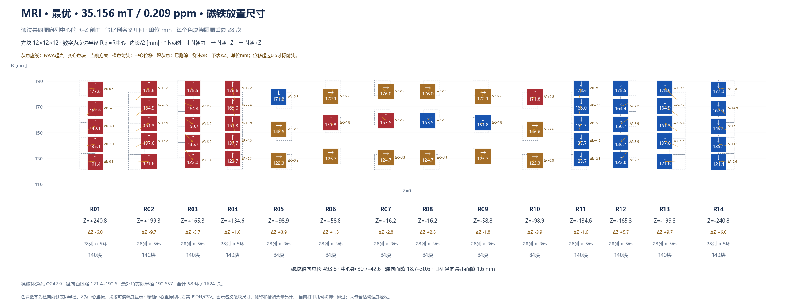

# 案例一：基于既有排布优化

从本目录的 `placement.json` 读取已有结构，先做源槽保留组合评估与 PAVA 最小改动投影，再调整磁环半径与镜像层轴向位置。原始文件包含 **14 层、62 个磁环、1736 块磁铁，每环 28 块**；工艺投影后的数量由制造审查决定，不能把原始裸磁体直接当成可打印起点。



上图为历史代表性结果：20 mm 平面 FOV、`remanence` 模型，35.155705 mT / 0.208702 ppm / 1624 块，未完成 FEM 求解验证。下方可运行配置的磁化近似、预算和搜索设置已有调整，不是上述历史指标的直接复现配置。真实设计与指标见 [reference_result](reference_result/metrics.json)。

| 配置项 | 本案例设置与含义 |
| --- | --- |
| 评价域 | **z = 0 平面、直径 20 mm 的圆形 FOV**；不是球形 DSV |
| 目标 | 平面面积加权平均场强 ≥ 30 mT、峰峰值不均匀度 ≤ 1000 ppm；通过门槛后继续降低 ppm |
| 包络 | 保护内孔直径 240 mm、外径上限约 384.187 mm、轴向总长上限 520 mm |
| 磁块 | 12 × 12 × 12 mm，Br = 1.43 T，μr = 1.05 |
| 工艺 | 径向通槽，允许同列磁块紧贴，禁止重叠；槽端与内外壁仍保留余量 |
| 数量策略 | 最多 1736 块；默认固定工艺投影后的环数与 28 列，连续优化 R/Z |
| 求解预算 | 2400 次优化求场，种群 32，坐标/成对精修 240 次，LP 精修 300 次；单进程 |

在**仓库根目录**完成依赖安装后启动：

```powershell
python py_main.py workbench serve --project results/seeded --config examples/seeded/config.json --port 8765
```

打开 `http://127.0.0.1:8765`，按 Step 1 → 6 执行。Step 3 对比原始排布与可打印起点；Step 5 启动前查看实际维数与预算预检；Step 6 查看密集复核结果和图纸。

也可在命令行运行全部步骤：

```powershell
python py_main.py workbench all --project results/seeded --config examples/seeded/config.json --no-compile
```

常用修改集中在 `config.json`：`target` 修改 FOV 与性能门槛，`envelope` 和 `manufacturing` 修改可用空间与打印工艺，`solver` 修改预算。需要搜索增减磁铁时，将 `search.optimize_azimuth_count` 与 `search.optimize_radial_ring_count` 设为 `true`，并重新执行 Step 3；同时检查数量上限与预算。

本案例默认导出 COMSOL Java，**无需安装 COMSOL 也能完成 Python 优化与归档**。要编译 `.class`，填写本机 `comsol_root` 并启用 `deliverables.compile`，然后在 Step 6 编译。Python 的孤立立方体自退磁修正是近似模型；最终性能应由密集复核、COMSOL FEM 与实测确认。另一案例使用 100 mm 球形 DSV，两者 ppm 不可直接横向比较。
